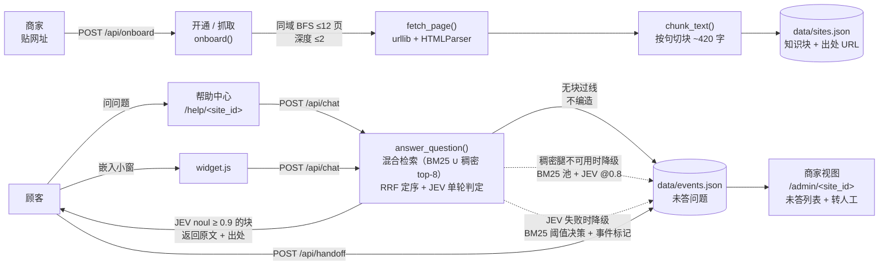

# 架构说明 — 小电商 AI 客服 MVP（试水版）

> 一句话：**单文件抽取式问答原型**——检索用混合检索（BM25 ∪ BGE-M3 稠密腿）出候选池、RRF 定序、取舍由 JEV 决策模型逐块判定，不让生成式模型改写答案。快是因为砍得狠——只验证一条链路，难的部分（订单、平台对接、账号、部署）全部没做。

## 全景图



## 代码结构（就一个文件）

服务本体在 `app.py`（约 690 行）：Web、抓取、BM25 与 JEV 调用只用 Python 标准库，无构建步骤；唯一的第三方依赖是稠密腿的 sentence-transformers / torch，只装在 `eval/.venv-emb` 里、懒加载，加载不了就整腿关闭降级（见问答检索行）。

| 模块 | 位置 | 做什么 |
|---|---|---|
| 页面解析 | `PageParser`（`HTMLParser` 子类） | 去掉 script/style，抽标题、正文、链接 |
| 抓取 | `fetch_page()` | urllib 请求（超时 8s、上限 800KB），只收 HTML |
| 开通建库 | `onboard()` | 从商家网址同域 BFS：最多 12 页、深度 ≤2；链接按关键词打分（product / faq / shipping / return / policy 等）优先政策与产品页 |
| 切块 | `chunk_text()` | 按句切分，约 420 字一块、不足 60 字丢弃；每块保留来源页 URL 和标题 |
| 问答检索 | `answer_question()` | 混合检索：BM25 腿（分词→同义词扩展→内存 SQLite FTS5 索引，全部命中块）∪ 稠密腿（本地 BGE-M3，问题向量对全部块算余弦取 top-8；块向量建站时算好存进站点记录，旧站点首问惰性回填）→ 并池去重、RRF（k=60）定序 → JEV（TypeSafe System One）一次请求逐块打 Noul 概率，≥ 0.9 的块按 RRF 序拼 **原文返回**，一块没过线则兜底。沿革：2026-11-14 TF-IDF → BM25（S1 26/55 vs S0 24/55）→ 按第二轮校准换上 JEV 决策层 @0.8 → 第三轮混合臂 S5b 新题库 48/50 vs 对照 20/50（英文改写/中文/日文答题组池召回 100%）但兜底 83.3% 未过 90% 预注册线 → 第四轮预注册校准接受线 0.9（v4 陷阱加权题库 39/40、兜底 97.1%、编造 0，第三轮题集复判 49/50、96/100）后切换为现行混合管线（`eval/README.md`、`eval/prereg-round3.md`、`eval/prereg-round4.md`）。降级梯（每档皆已验证配置）：稠密腿不可用（普通 python3 启动/模型加载失败）→ BM25 池 + JEV @0.8（原 S2-cal），事件记 `decision="bm25-jev"`；JEV 失败（连接器缺失/超时/报错）→ BM25 阈值（best bm25 ≤ -1.0，含同页第二块规则），事件记 `decision="bm25-threshold"`；两档 `degraded=true`，主档记 `decision="hybrid-jev"` |
| 存储 | `load_json / save_json` | 两个 JSON 文件搞定：`sites.json`（站点+知识块）、`events.json`（提问/未答/转人工事件）；写文件用临时文件 + 原子替换 |
| Web 服务 | `Handler`（`ThreadingHTTPServer`） | 见下方路由表；页面是内嵌 HTML 字符串，没有前端框架 |
| 嵌入窗 | `WIDGET_JS` | 一段原生 JS：右下角按钮 + 面板，直接调 `/api/chat` |

## 路由

| 方法 | 路径 | 用途 |
|---|---|---|
| GET | `/` | 落地页：开通框 + 已开通站点列表 |
| POST | `/api/onboard` | 贴网址 → 抓取建库 → 返回 site_id、页数、知识块数 |
| GET | `/help/<site_id>` | 顾客帮助中心（示例问题 + 提问 + 转人工表单） |
| GET | `/widget.js?site=<site_id>` | 商家站点嵌入脚本 |
| POST | `/api/chat` | 提问 → 带出处回答，或兜底转人工并记未答 |
| POST | `/api/handoff` | 转人工提交（邮箱 + 问题描述） |
| GET | `/admin/<site_id>` | 商家视图：未答列表、转人工列表、知识来源页 |
| GET | `/api/sites` | 已开通站点列表（落地页用） |

## 关键设计决定（为什么这么做）

1. **抽取式回答，不用 LLM 改写**：直接引用站内原文 + 出处链接。试水阶段防编造比文采重要——政策答错的代价是商家惹麻烦，所以宁可答不出，也不编。
2. **判定兜底是功能，不是失败**：JEV 没有一块给到接受线（混合池 0.9 / BM25 池 0.8）一律判无依据 → 记录为「未答问题」+ 引导转人工。这份未答清单就是卖给商家的第二份价值（他该补哪条 FAQ）。降级时兜底语义不变、事件里留档位与降级标记。
3. **服务本体零依赖，稠密腿可选**：Web/抓取/BM25/JEV 只用标准库；稠密腿（BGE-M3）是唯一第三方依赖，懒加载且整腿可关——用普通 `python3` 启动照样服务，只是退回上一代已验证的 BM25+JEV 配置。代价是没有正经分词（BM25 腿对中日问题为空，靠稠密腿补）、没有向量数据库（块向量存 JSON、余弦纯 Python 现算，几百块以内够用）、没有并发与安全加固。
4. **单机 JSON 存储**：试水够用；数据模型就是站点 → 页面 → 知识块，以及一条事件流，后续换 SQLite / Postgres 不用改接口。

## 明确没做（第二步才碰）

- 订单查询、退款执行 —— 碰钱和履约，第一版一律转人工
- WooCommerce / Shopify 对接 —— 先证明独立帮助中心形态有人愿意用
- 商家登录 / 权限 —— `/admin/<site_id>` 现在靠 site_id 直达，**不能暴露给真实顾客环境**
- 多语言界面与商家侧配置 —— 问答本身已能答中日问题（稠密腿覆盖，第三轮题库实测中日答题组池召回 100%）；但 BM25 腿的分词与同义词表仍只有英文，帮助中心文案也还是中文单语
- 部署 / HTTPS / 限流 —— 目前只监听 127.0.0.1 本地运行

## 已知毛病（烟测确认过）

- 回答偶尔带入来源页的导航文字（切块时没完全过滤）。
- 示例问题是规则生成的（页面含 return / shipping / faq 才出对应题），不是真「顾客最常问」——试水版的 20 题要按商家品类人工套框架，见 `trial/01-demo-and-outreach.md`。
- 抓取只跟同域链接，JS 渲染的站点可能抓不到正文。

## 烟测记录（2026-11-14，虚构店 Momo Ceramics；混合管线 + JEV @0.9 切换后复跑）

- 冻结题库一致性：线上 `answer_question`（venv 解释器、稠密腿开启）直跑 `questions-v4.json` 全部 195 题，195 题全部走主档（`decision="hybrid-jev"`、`degraded=false`）；与 eval 在 0.9 线的记录判定逐题比对：v1+v2 96/100、v3 49/50、v4 39/40，总数全对。仅 2 题判定不同，且同属「次日达」陷阱家族、方向相反互抵：V3Z15 记录 noul 0.90 → 线上 0.89（改判兜底正确）、V3J08 记录 0.89 → 线上 0.92（改判误收）——JEV 在 0.9 线附近的运行间抖动，即第四轮已登记的残余风险，非管线差异。v1 的 5 道中文探索题（无混合基线）线上全部命中。
- HTTP 烟测（venv 解释器、真实已存站点，开通于旧版本、无向量）：「How long does shipping take?」→ 物流页原文带出处；中文退货问题（BM25 分词为空、纯稠密腿出池）→ 退换页原文带出处；「Can I change the delivery address after placing an order?」陷阱 → 正确兜底记未答、无编造；「Can I pay with Bitcoin?」→ 兜底转人工。四题事件均为 `decision="hybrid-jev"`；首问触发惰性回填，`sites.json` 已存入 12 条 1024 维块向量，旧站点零迁移可用。
- 降级验证：普通 `python3` 启动（稠密腿不可用）→ 改写题由 BM25+JEV @0.8 回答，事件记 `decision="bm25-jev"`、`degraded=true`；强制 JEV 失败（连接器置空）→ 退回 BM25 阈值决策，退换题分数 -4.237、物流题 -2.757，与 BM25 时代烟测记录逐字一致，事件记 `decision="bm25-threshold"`、`degraded=true`，服务不中断。

## 烟测记录（2026-11-14，虚构店 Momo Ceramics；JEV 决策层切换后复跑）

- 开通：抓 6 页 → 12 个知识块（与此前一致，旧站点数据零迁移可直接问答）
- 「How long does shipping take?」→ 物流页块 JEV noul 0.980 ≥ 0.8，命中原文带出处（其余候选最高 0.37）
- 「What is your return policy?」→ 退换页两块 noul 均为 0.980，拼答带出处
- 「Can I pay with Bitcoin?」→ BM25 零候选 → 正确兜底、记入未答、引导转人工，无编造
- 冻结题库一致性：现版 `answer_question` 直跑 `questions-v2.json`，新题集 39/45、兜底 15/16，v1 集 50/55、兜底 14/14，与第二轮成绩单逐题判定零差异
- 降级验证：人为断开 JEV（连接器置空 / 调用抛错）后，问答退回 BM25 阈值决策、答案不变，事件日志记 `decision="bm25-fallback"`、`degraded=true`，服务不中断

## 烟测记录（2026-11-14，虚构店 Momo Ceramics；BM25 切换后复跑）

- 开通：抓 6 页（首页 / 产品 / 物流 / 退换 / FAQ + 1）→ 12 个知识块
- 「What is your return policy?」→ 命中退换页原文，带出处（BM25 分数 -4.237）
- 「How long does shipping take?」→ 命中物流页原文，带出处（BM25 分数 -2.757）
- 「Can I pay with Bitcoin?」→ 站内无依据 → 分数 0.0，正确兜底、记入未答、引导转人工
- 转人工提交、帮助中心页、商家视图均验证可达

## 目录

```
app.py                  # 全部服务代码（单文件；稠密腿需 eval/.venv-emb 的解释器）
sample_store/           # 虚构示例小店 Momo Ceramics（烟测用）
eval/                   # 冻结题库实验（题库/预注册/成绩单）+ .venv-emb 稠密腿运行环境
trial/                  # 试水材料：演示话术 + 执行清单（不参与运行）
data/                   # 运行时生成（sites.json / events.json，已 gitignore）
```
