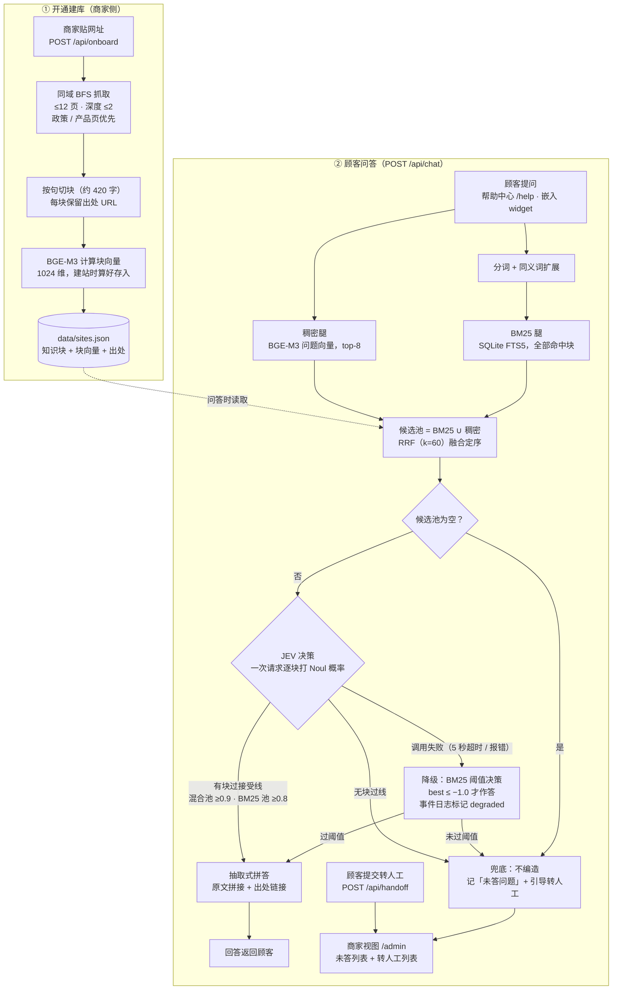

# 小电商 AI 客服 — MVP 试水版

**定位**：给小独立站商家的 AI 客服自助站。不依赖 Amazon / Etsy / Shopify 的收件箱规则，商家贴上自己网站地址即可生成。

**本版只验证一条链路**（试水，不是成品）：
商家贴网址 → 自动抓取产品 / FAQ / 物流 / 退换政策页 → 生成知识库 → 顾客在帮助中心或嵌入 widget 里提问 → 有依据就引用来源回答，没依据就记录为「未答问题」并引导转人工。

**明确不做**（第一版）：订单查询、退款执行、平台对接（WooCommerce / Shopify 放第二步）、多语言、商家后台登录。回答采用抽取式（直接引用站内原文 + 出处），不让模型编造政策。

**架构**：单文件 `app.py`，检索 + 决策三段：混合检索出候选池（SQLite FTS5 BM25 全部命中块 ∪ 本地 BGE-M3 稠密腿 top-8，RRF 融合定拼答顺序）→ JEV 决策模型单轮判定（TypeSafe System One，逐块打 Noul 概率，混合池 ≥ 0.9 才引用）→ 无依据兜底。2026-11-14 按冻结题库实验四轮演进：TF-IDF → BM25（S1 26/55 vs S0 24/55）→ JEV 决策层 @0.8（第二轮校准：新题集 39/45、兜底 93.8%、v1 回归 50/55）→ 混合检索 + JEV @0.9（第三轮 S5b 新题库 48/50 vs 对照 20/50、池召回 100%，但兜底 83.3% 未过预注册线；第四轮校准接受线 0.9 后 v4 陷阱加权题库 39/40、兜底 97.1%、编造 0，第三轮题集复判 49/50 与 96/100），见 `eval/README.md`。降级梯每一档都是验证过的旧配置：稠密腿不可用 → BM25 池 + JEV @0.8（原 S2-cal）；JEV 不可用 → BM25 阈值决策（best bm25 ≤ -1.0）；事件日志记明档位与 `degraded` 标记，不中断服务。全景图、路由表与设计决定见 [ARCHITECTURE.md](ARCHITECTURE.md)；给商家的演示话术与试水执行清单在 `trial/`。

## 流程图



降级说明：稠密腿不可用（普通 `python3` 启动 / 模型加载失败）时候选池只剩 BM25 腿、JEV 接受线降为 0.8（图中的 BM25 池口径）；JEV 本身不可用时走图中的 BM25 阈值降级。每一档都在事件日志里记 `decision` 与 `degraded`，顾客侧回答格式不变。

## 运行
```bash
cd ~/workspace/ecommerce-ai-support
# 主档（混合检索）：必须用 eval venv 的解释器启动——稠密腿的 torch /
# sentence-transformers 只装在那里；HF_HUB_OFFLINE=1 让模型走本地缓存
# （app.py 启动时也会自动设这两个变量，下面的写法是明示口径）：
HF_HUB_OFFLINE=1 eval/.venv-emb/bin/python app.py 8078   # http://127.0.0.1:8078
# 另开一个终端，启动示例小店（测试用虚构店 Momo Ceramics）：
python3 -m http.server 8077 --directory sample_store
```
打开 http://127.0.0.1:8078 ，在开通框里填 `http://127.0.0.1:8077/` 即可跑通全链路；帮助中心在 `/help/<site_id>`，商家视角（未答问题 + 转人工列表）在 `/admin/<site_id>`，嵌入代码是 `<script src="http://127.0.0.1:8078/widget.js?site=<site_id>"></script>`。

说明：
- 用普通 `python3 app.py 8078` 也能启动和服务，只是稠密腿加载不了，自动降级为 BM25 + JEV @0.8 档（事件日志 `decision="bm25-jev"`、`degraded=true`）。
- 块向量在建站时算好存入站点记录（`sites.json` 的 `embeddings` 字段，1024 维）；旧版本建的站点第一次被问到时惰性回填，不需要迁移。
- 每题延迟预期约 1.1 秒（p50，本 VM 共享 CPU 上题库实测口径；独占部署只会更快）。

## 试水指标（拿给真实商家之前先定好）
- 开通：商家从贴网址到能提问 ≤ 3 分钟，不需要技术协助。
- 命中：用商家真实 FAQ 测 20 个问题，≥ 14 个能给出带出处的正确答案。
- 兜底：答不出的问题 100% 进未答列表，绝不编造。
- 付费信号：3 个商家愿意给真实站点试用 ≥ 1 周；≥ 1 个愿意付首月费（$49–99 档）→ 继续；否则砍掉或换切口。

## 合规与边界
- 只抓商家自己的站、且须商家授权后再用于真实顾客；遵守站点 robots 与条款。
- 涉及订单、支付、退款的问题一律转人工，第一版不碰。
